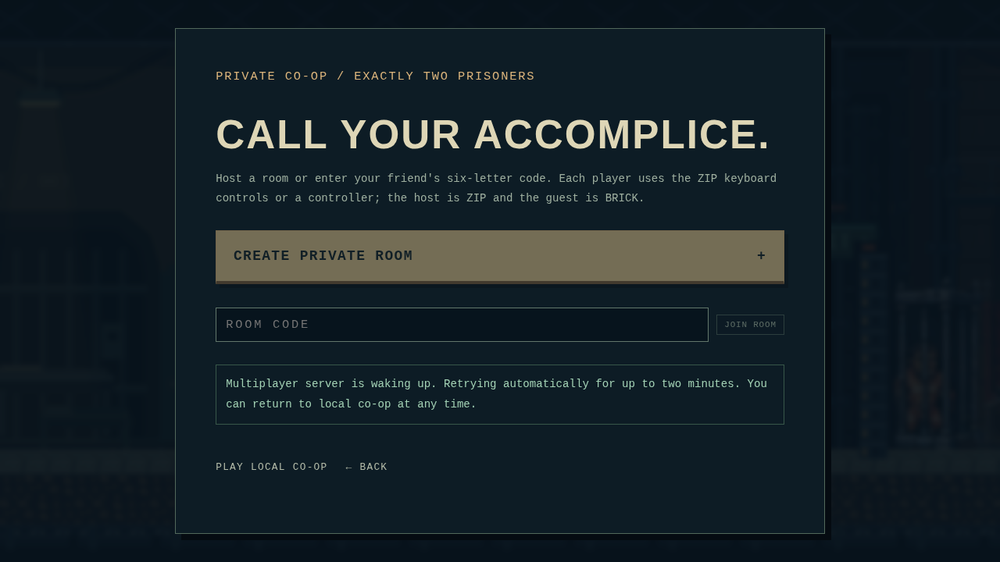
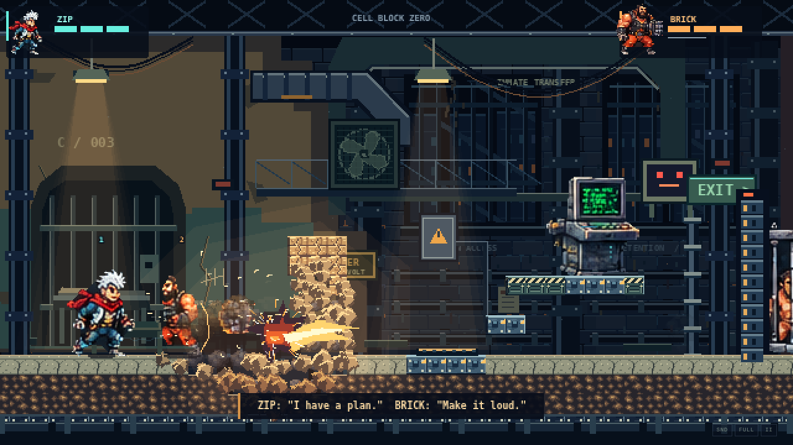
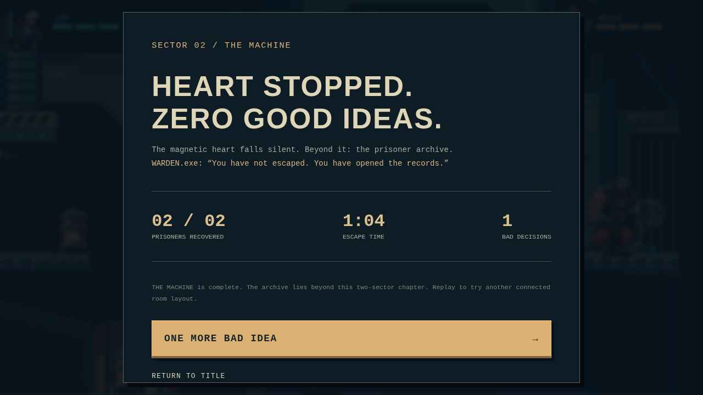

# Free-hosting deployment validation

**Public deployment: not performed.** No Vercel or Render URL is verified. Account authorization and the real-host acceptance test remain required. [Exact setup and environment variables](../../docs/FREE_DEPLOYMENT.md).

The captured frontend is the production Vite bundle. The backend is the built Docker image, running locally as UID 1000 on injected port 10000. A test-only HTTPS/WSS proxy provides localhost TLS; it is not a public hosting service and is not shipped in the backend image.

- [Two independent production browsers](production-online-evidence.json): invite link, real UI and keyboard inputs, both sectors completed, movement/destruction, reconnect and identical final snapshots. No development hooks or simulation writes.
- [Docker evidence](docker-evidence.json): full shared-module tree including `machine.ts`, non-root startup, assigned port, missing-origin startup rejection, and no retained build certificate.
- [Server checks](server-security-evidence.json): health GET/HEAD 200; allowed upgrade 101; absent/null/unauthorized origins 401.
- [Network combat and rescue](network-action/network-evidence.json), [full authoritative campaign](network-machine/network-evidence.json).
- [Validation summary](validation.json): test commands, log hashes, unchanged gameplay/assets and evidence hashes.

Browser screenshots are real captures. The unavailable-server case deliberately rejects connections to test retries/cancellation and local play. It is not evidence of a real Render cold start. No screenshots, localhost URL or passing build is presented as a public deployment.
