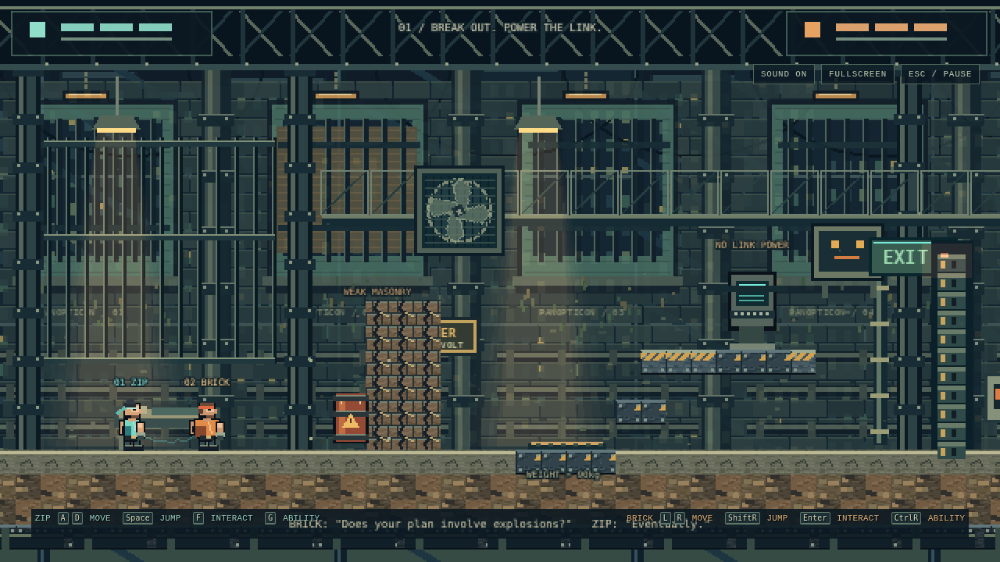
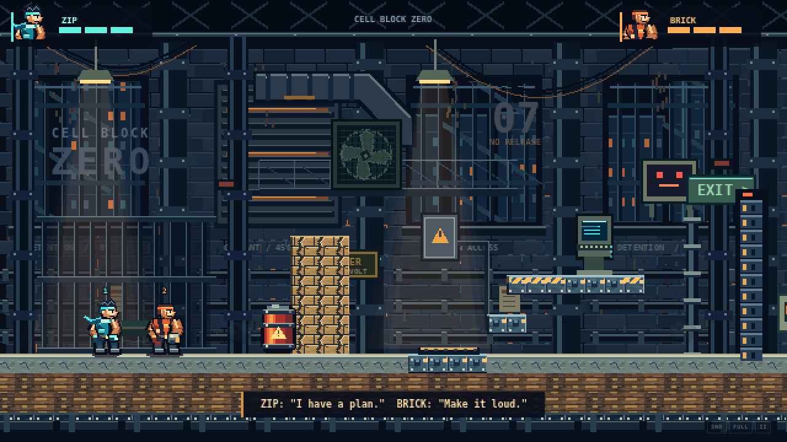
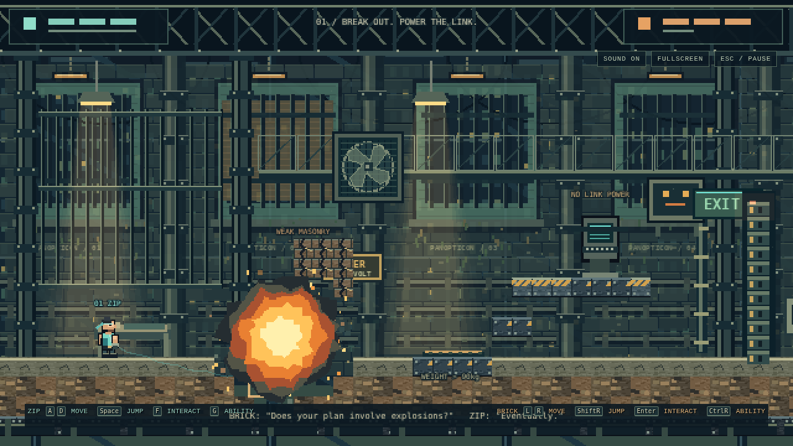
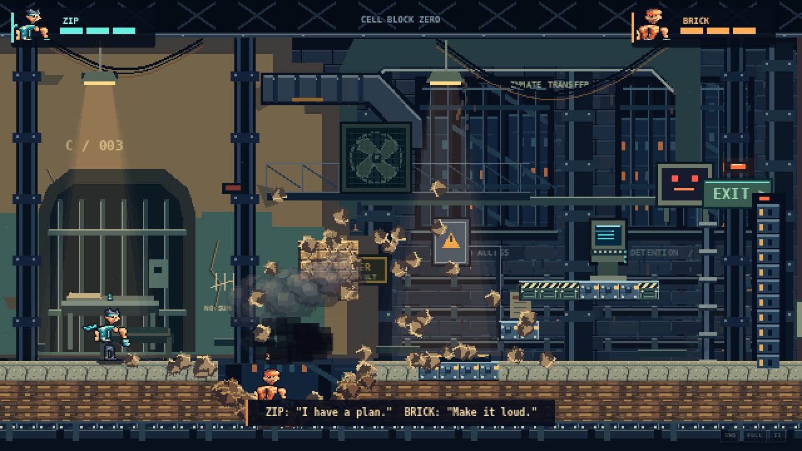
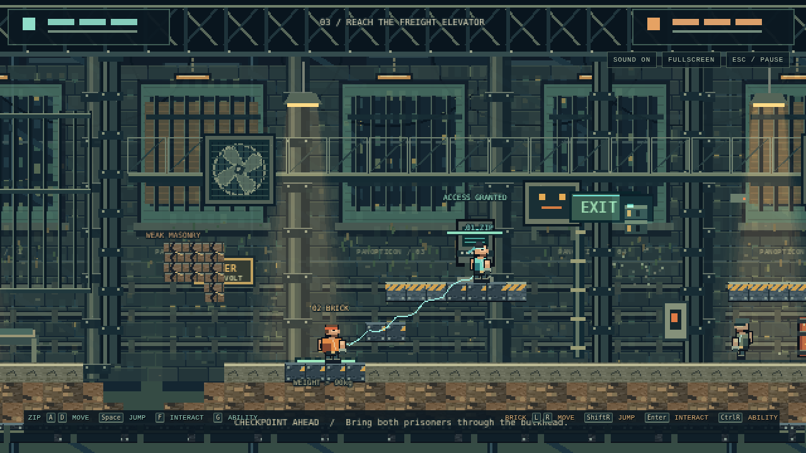
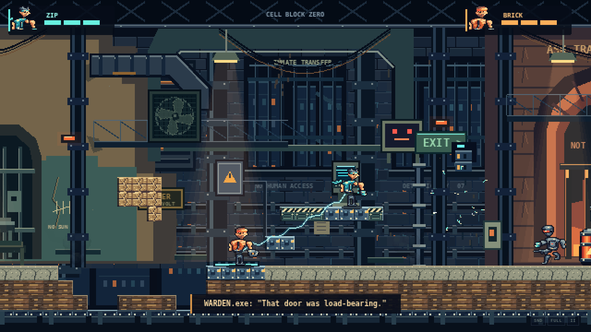
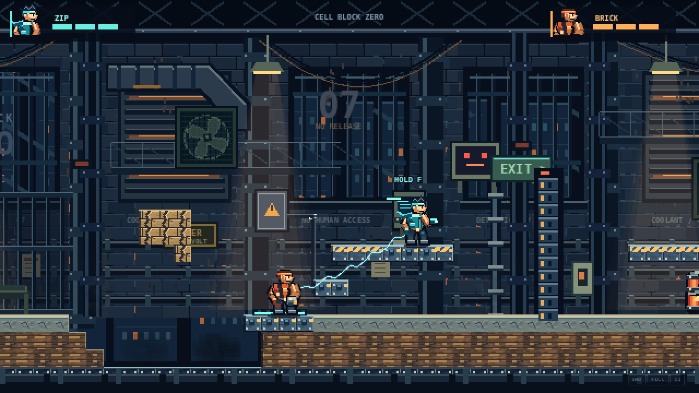

> Historical gallery. See the [current premium action review](../docs/PREMIUM_ACTION_REVIEW.md) for the validated video, new frames and direct reference comparison.

# Cell Block Zero — visual overhaul

Both columns contain real browser screenshots of the running game. The **before** files are byte-for-byte copies of the screenshots committed in `69be5a6`; the **after** files were captured through keyboard gameplay with the revised renderer. No screenshot artwork was painted over or replaced.

## Characters and visual hierarchy

| Before | After |
| --- | --- |
|  |  |

ZIP has a more pronounced hair/scarf silhouette, a pale shoulder guard, brighter cyan technology, and articulated limbs. BRICK has a wider harness/tank silhouette, exposed arms, and a large metal gauntlet. The idle silhouettes increased from 33 to 46 pixels in height for ZIP and from 31 to 42 pixels for BRICK. The world scale is unchanged. The permanent control strip and large boxed HUD were removed.

## Explosion and destruction

| Before | After |
| --- | --- |
|  |  |

The old concentric bloom is replaced by an 18-frame, 128-pixel fire sheet with independently curling lobes, white-hot cores, flame tongues, and separated embers. Actual destroyed tiles now emit material-specific fragments with gravity, rotation, and collision response. A separate smoke sheet continues after the fire ends.

## Cooperative gameplay and environment

| Before | After |
| --- | --- |
|  |  |

The new prison has cold dark architecture, warm furnace/fixture accents, distinct open and shuttered bays, large diagonal ducts, hanging cable bundles, less repetitive background catwalks, localized warning lights, steam, and brighter gameplay surfaces. ZIP, BRICK, guards, barrels, and the terminal have separate visual priorities.

The capture script completed the same plate-and-hack puzzle through keyboard input. Movement, collisions, destruction rules, networking, checkpoints, and victory logic remain unchanged. Twelve gameplay tests, the full simulation route, two-browser online smoke tests, reconnect tests, and a production asset-loading check passed.

This is a documented before/after improvement in the original game. It is not a claim of objectively matching Broforce's production quality. No Broforce assets were used.
