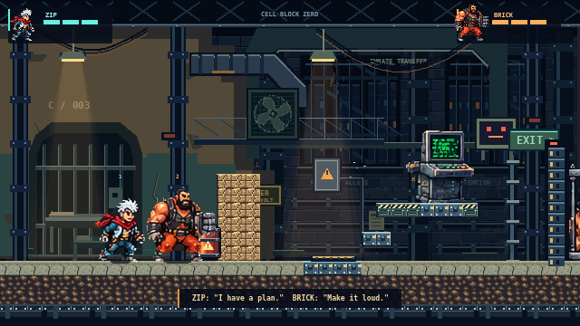
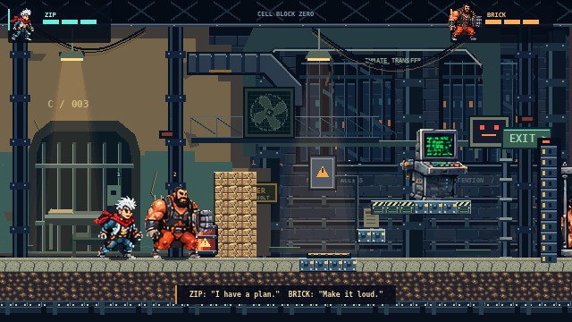
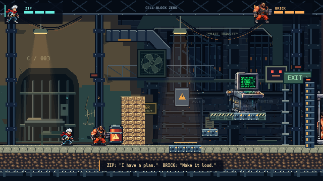
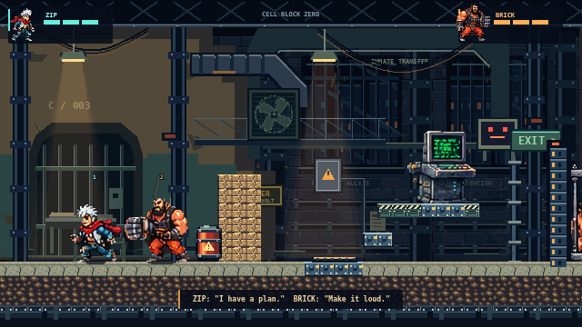
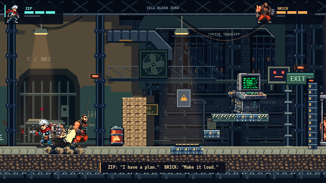

# Animation and scale correction — incomplete art milestone

Continued on `approved-art-integration` from `fed52c9`. The supplied character **identities are accepted**, but this pass **does not meet the requested convincing-animation success criterion**. No new illustrated frame or anatomy repair is claimed. Main is not merged.

The available tooling can measure assets, package editable source documents, integrate authored frames and verify real gameplay. It has not produced the consistent, individually illustrated anatomy required for a professional eight-frame run cycle and the missing combat/recovery drawings. Rather than fill the atlas with duplicated, warped, interpolated or generated anatomy, this delivery preserves the working game and provides explicit production files and remaining artist tasks.

## What changed in the playable game

Only three distant Cell Block Zero image layers receive restrained brightness tints: far `#8594ab`, mid `#9cabb9`, prison composition `#b4bac4`. Characters, foreground collision terrain, lamps, hazards, terminal, rescue, flags and effects retain their prior colors. This reduces some background competition without concealing the sprite defects or claiming that contrast fixes animation.

Hero artwork, runtime 1× source scale, pose selection, animation anchors and all authoritative gameplay remain unchanged. The original 83 supplied files and both runtime hero atlases are byte-identical. Physics, multiplayer protocol, destruction, rescue, checkpoint, generation and both sectors retain their existing behavior.

## Actual scale audit and choice

The simulation uses a **14×25 collider** and **16px tiles**, rendered on a native **640×360** canvas. The source idle frames contain 70px-tall ZIP and 81px-tall BRICK. The full source frames remain 96×96; alpha bounds, not cell size, measure apparent character height. All 25 source hero poses are measured in [scale-audit.json](../art/animation-production/scale-audit.json).

| Uniform source scale | ZIP standing height | BRICK standing height | Result |
|---|---:|---:|---|
| 1× integer | 70px / 4.375 tiles / 2.8 colliders | 81px / 5.063 tiles / 3.24 colliders | Existing oversized integration |
| 2× integer | 140px / 8.75 tiles | 162px / 10.125 tiles | Reject: disproportionate, overlaps partner/scenery |
| 3× integer | 210px / 13.125 tiles | 243px / 15.188 tiles | Reject: dominates the viewport |
| 1:2 nearest-neighbor diagnostic | 35px theoretical | 40.5px theoretical | Better world proportion; loses face/equipment clusters and introduces raster rounding |
| 1:3 diagnostic | 23.33px theoretical | 27px theoretical | Too little identity detail; reject |
| **New native drawing target, at 1×** | **34px / 2.125 tiles / 1.36 colliders** | **40px / 2.5 tiles / 1.6 colliders** | Selected production dimensions; **artwork still missing** |

There is no positive integer scale below 1. Therefore integer scaling alone cannot make a 70–81px drawing fit this 25px collider coherently. The selected production solution is **deliberate native-size illustration**, preserving the original identities, not an automatic shrink-and-claim pass. The game stays at its existing 1× scale pending that artwork. This is a documented limitation, not a completed scale correction.

The reduction previews are diagnostic render settings only and are **not shipped**, not new artwork, and not claimed as acceptable sprite sheets. All candidates use unchanged real gameplay positions and world geometry; only hero render scale changes. Yellow overlays show the actual collider. HUD portraits, enemies and world assets remain fixed as reference points.

| Actual native gameplay | Inspect |
|---|---|
|  | [2× enlargement](../artifacts/animation-review/idle-current-2x.png) |
|  | [2× enlargement](../artifacts/animation-review/idle-previous-background-2x.png) |
|  | [2× source-scale candidate](../artifacts/animation-review/idle-scale-2x-colliders.png) · [3× candidate](../artifacts/animation-review/idle-scale-3x-colliders.png) |
|  | [2× inspection enlargement](../artifacts/animation-review/idle-scale-half-diagnostic-2x.png) |
|  | [2× enlargement](../artifacts/animation-review/running-current-2x.png) |
|  | [2× enlargement](../artifacts/animation-review/combat-current-2x.png) |

The “previous background” view restores the exact pre-change white tint on the same three layers at the **same paused simulation tick**. It is an in-engine comparison of this change, not a separately staged mockup. Before/after/restored captures keep the entire snapshot unchanged; restored images are byte-identical. Enlargements are verified exact nearest-neighbor copies.

## Editable art production files

[Production instructions](../art/animation-production/README.md) · [Frame specification](../art/animation-production/animation-spec.json) · [Exact repair brief](../art/animation-production/REPAIR_BRIEF.md).

- Native unchanged reference sheets: [ZIP](../art/animation-production/zip-reference.png), [BRICK](../art/animation-production/brick-reference.png).
- Original-size editable repair documents: [ZIP](../art/animation-production/zip-repair.ora), [BRICK](../art/animation-production/brick-repair.ora). Each has an editable atlas copy, hidden original reference and empty repair paint layer. **The defects have not been repaired.**
- New-scale editable animation templates: [ZIP](../art/animation-production/zip-animation-template.ora), [BRICK](../art/animation-production/brick-animation-template.ora). Each has a blank paint layer and removable ground/root/collider/head-height guides. **These contain no completed character artwork and are not runtime assets.**

OpenRaster is supported by GIMP and Krita. Archive structure, layer images, dimensions and original reference pixels were validated. Direct editor import was not verified: installed GIMP could not start without an X display. No claim of an editor-open check is made.

The specifications require **39 distinct drawings per hero, 78 total**: idle 4, run 8, jump 3, fall 2, land 3, attack 6, hurt 2, death 6, revive 5. All are explicitly marked **missing**. Each has a pose brief, timing, atlas cell and stable root anchor. Planned cycles track travel distance to reduce foot sliding; no such playback is shipped before artwork exists.

The timing notes follow the actual simulation: ZIP fires on the first action tick; BRICK hits after his existing 140ms wind-up; landing lasts 100ms; revival is the revived hero's 450ms recovery after the partner interaction. The artist must align release/contact to these rules rather than changing authoritative attacks to fit a drawing.

The repair brief identifies BRICK's detached 632-pixel fist and partial body in punch, his hurt/charge fragments, ZIP's floating scarf pieces and unsuitable upright death pose. Connecting the fist by translating a component would not reconstruct missing anatomy. These repairs require new illustrated clusters, followed by the full run and recovery drawings. No masking, generated replacement characters or automatic anatomical operations were used.

## Gallery and real footage

[Interactive animation audit gallery](../artifacts/animation-review/index.html) · [New 15-second gameplay MP4](../artifacts/animation-review/action/gameplay-15s.mp4) · [Original recording](../artifacts/animation-review/action/gameplay-source.webm) · [Previous integration video](../artifacts/supplied/action/gameplay-15s.mp4).

Run `npm run dev` and open `/artifacts/animation-review/index.html` for the interactive gallery. GitHub displays HTML source; the Markdown images and MP4 download work directly there. The gallery includes native/2× comparisons, all 25 original pose cells, required frame briefs and editable file downloads. It deliberately does not play duplicated poses as if they were authored cycles.

The new continuous gameplay capture recorded **378 rendered frames over 17.043 seconds**, with ordinary input, actual guard shots, electrical charge, BRICK's punch, rescue, chain explosions and escape. The export is the first **15.000 seconds**, 640×360, H.264/AAC, 450 CFR frames. CFR may repeat real frames; no interpolation, compositing, substitute imagery or speed change is used. This headless capture is not a 60fps GPU benchmark. It visibly retains the single-pose run limitation.

## Validation

- Production TypeScript/Vite build passed. Existing bundle-size advisory remains.
- All **37 gameplay tests in six files** passed.
- Local browser UI, control remapping, movement, jumping, destruction, pause and resize passed.
- Production browser loaded all **23 PNG assets** with no browser/HTTP errors and no development inspection hook.
- Network room readiness/capacity, authoritative input, disconnect/reconnect and tamper rejection passed.
- Real online rescue, partial-hold freeze during disconnect, resumed completion, combat/destruction and saved state passed.
- Full local two-sector browser campaign and replay reset passed.
- Full authoritative two-sector campaign, puzzles, chase/boss/exit and reconnect passed.
- Two independent browser clients completed The Machine with identical final snapshots.
- All 57 supplied frames in both directions passed **114 exact pixel comparisons** against their original atlases.
- Gallery checks passed for **34 gameplay image views**, all 25 original hero poses, 78 missing-frame briefs, four editable downloads and actual MP4 playback.

Machine-readable records are in [artifacts/animation-review](../artifacts/animation-review), including [readiness](../artifacts/animation-review/production-readiness.json), [scale evidence](../artifacts/animation-review/scale-capture-evidence.json), [render checks](../artifacts/animation-review/render-evidence.json), [gallery checks](../artifacts/animation-review/gallery-evidence.json) and [media verification](../artifacts/animation-review/action/media-verification.json).

Render/pose-selection tests establish that existing pixels, anchors and state selection work. **They do not establish animation quality.** The remaining acceptance gate is illustrated model cleanup, completed cycles, native in-game review and user approval. No merge to main or visual approval is claimed.
