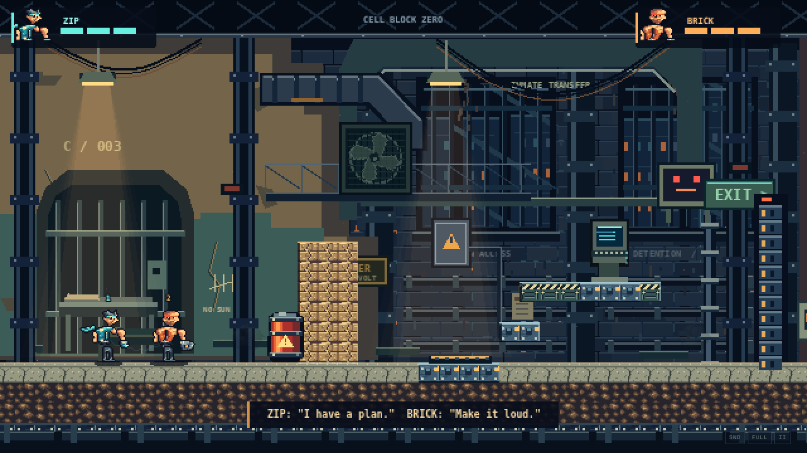
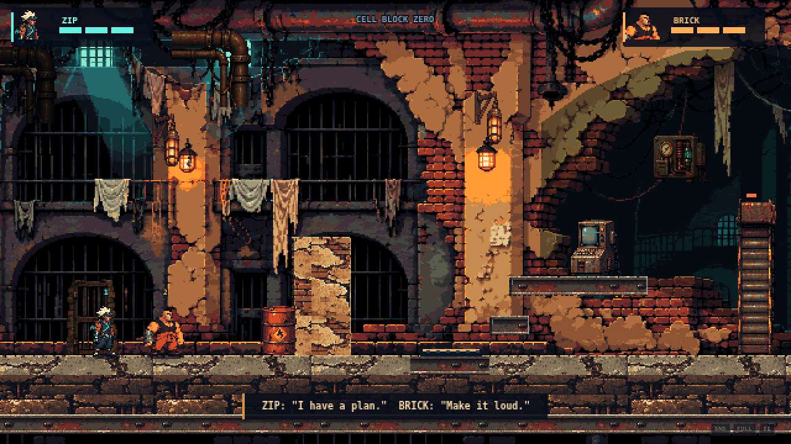
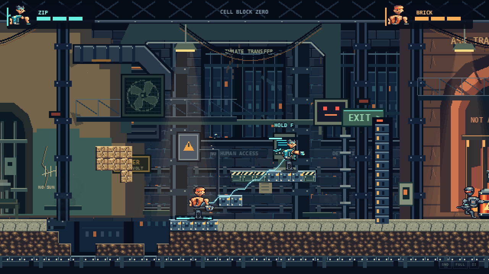
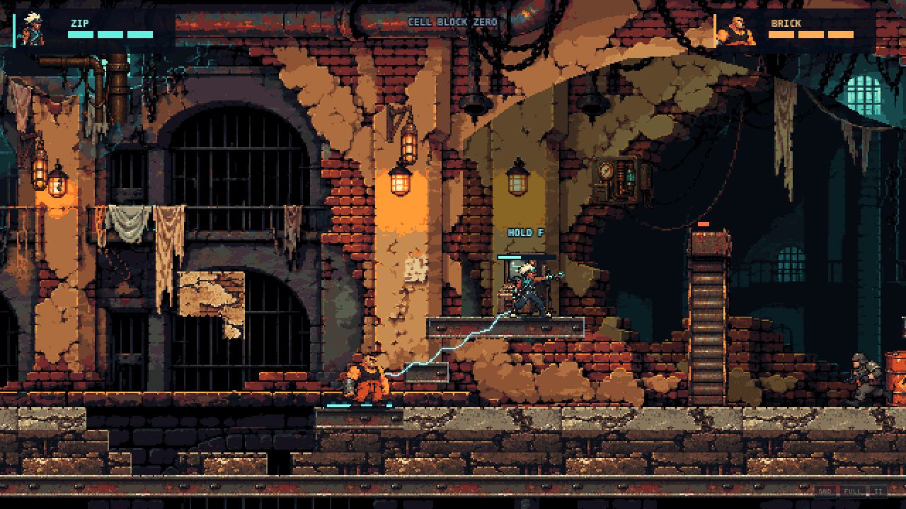
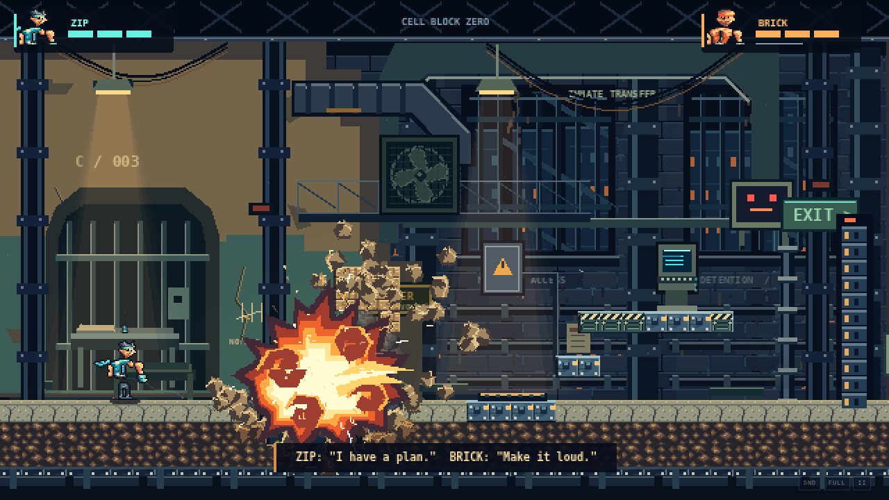
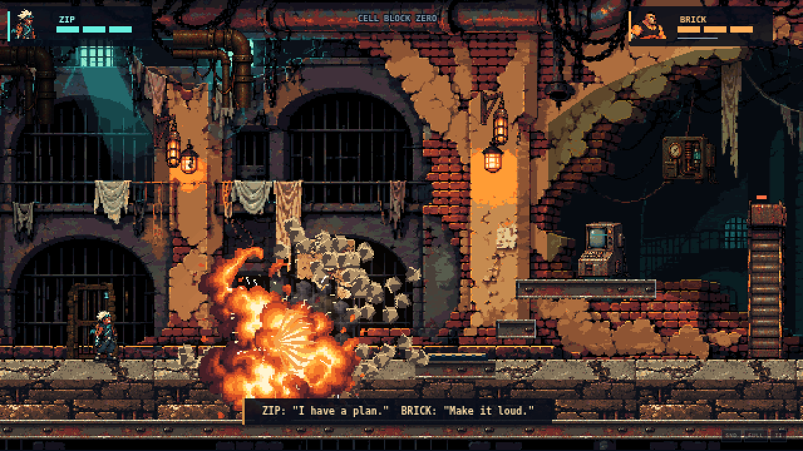

# Cell Block Zero: replacement art foundation

Base: `69eba18`. Review branch: `art-direction-reboot`. Scope: the existing continuous Cell Block Zero prison hall, concentrating visual review on the opening breach/terminal screen. No new sector, layout, boss, mechanic, multiplayer feature, menu or story was added. The shared simulation, collision definitions and server are unchanged. THE MACHINE restores its existing actors, tiles, props and fire after the transition.

## Before / after — actual rendered output

| Before at 69eba18 | Replacement art |
|---|---|
|  |  |
|  |  |
|  |  |

[Interactive comparison page](../artifacts/reboot/index.html) — serve the repository with `python -m http.server 8000` and open `/artifacts/reboot/`; GitHub's file viewer displays its source rather than executing HTML. The table above works directly on GitHub.

[15-second real gameplay MP4](../artifacts/reboot/after/action/gameplay-15s.mp4) · [Uncut source WebM](../artifacts/reboot/after/action/gameplay-source.webm) · [Verified file hashes](../artifacts/reboot/verification.json).

Playwright entered the existing local game through its UI and dispatched ordinary keyboard events. The developer inspection hook was read only; no teleportation, invulnerability, terrain injection, mock rendering or prerecorded simulation was used. The six comparison screenshots in each set are 1280 × 720 displays of the same 640 × 360 game. Capture ticks differ and particles/shake are nondeterministic; these are equivalent situations, not pixel-identical replay frames. The action screenshots and video are the native 640 × 360 canvas, captured after rendering.

## What changed in the art approach

Seven original source illustrations replace procedural geometric architecture/anatomy as this screen's primary art: prison panorama, three character key sheets, material panels, props and evolving fire. The backdrop was then revised after native gameplay inspection to remove granular speckling from the broad plaster. The first source and [first rendered iteration](../artifacts/reboot/iteration-1/environment.png) remain available. Floor material variation was widened, exposed terrain edges gained small authored chips, and pose baselines were aligned after BRICK appeared to float.

This is **AI-assisted illustration followed by technical pixel import and review**, not an assertion that a professional artist placed every pixel. The provided image-generation tool can create original illustrations and pose sheets, but does not guarantee native-size animation consistency or the selective cluster craftsmanship of an experienced pixel artist. Palette conversion alone cannot supply that judgment. This is a concrete visual direction for review, not certified production art or commercial parity.

The [editable PNG masters and specification](../art/reboot/README.md) are compatible with Aseprite/LibreSprite. Regular asset builds copy them without overwriting edits. An explicit re-import script retains source-to-runtime crop, palette, pose and tile mappings. No Broforce artwork is included in the game or asset sources.

## Direct reference study and application

References viewed in this pass:

1. [Broforce temple/co-op screenshot](https://raw.githubusercontent.com/VirtualCup/Broforce_CN/main/Preview/Preview_2.png), from the VirtualCup localization project's preview.
2. [Broforce industrial platforms](https://raw.githubusercontent.com/Gorzontrok/Mods-Broforce/master/Spooktober/.img/Another-Map.jpeg), explicitly a Spooktober community-mod screenshot.
3. [Broforce terrain silhouette](https://raw.githubusercontent.com/Gorzontrok/Mods-Broforce/master/Spooktober/.img/A-Map.jpeg), also a community-mod screenshot.

These are quality/composition references, not proof that every pictured asset belongs to the stock game's art set. They are linked externally, not redistributed in the repository. The comparison page shows each at 640px frame width beside our rendered scene; source native pixel scales are unknown. Additional downloaded localization previews depicted a world map, menu and results screen and were not used as action-scene evidence.

| Observation from the real references | Applied to this original prison | Remaining difference |
|---|---|---|
| Terrain highlights concentrate along broken edges; interiors are quiet. | Chipped plaster and uneven arches surround dark barred recesses. Live tile neighbors select chipped exposed edges. | Damage still carves 16px collision-grid shapes, and floor cracks repeat. |
| Dark voids make small heroes readable. | Quiet blue-black depth, ivory/mint ZIP and orange BRICK, muted olive guards. | ZIP's face and glove need cleaner native-size clusters; warm BRICK can blend with the brightest plaster. |
| Wood, metal, stone and vegetation have distinct silhouettes and thickness. | Plaster/brick, rusted I-beams, slabs and dark foundation use separate illustrated panels. | Existing horizontal collision topology limits varied structural thickness. This pass intentionally does not redesign gameplay. |
| Foreground edges, distant silhouettes and intermediate structures establish depth. | Separate arch mask, slow cell-depth plane and nearer pipes; shaded small props. | The split depth source repeats architectural motifs; a bespoke distant layer would be stronger. |
| Small props suggest use and damage. | Torn laundry, bent bars, damaged fan, cable loops, CRT terminal, corroded barrel and cabinet. | Some props retain generated perspective; signage/personality is less specific than bespoke production art. |
| Compact characters use exaggerated silhouettes and action poses. | Distinct running contacts/passes, brace, wind-up, strike, recoil and defeat keys at the existing scale. | Limb/equipment continuity and in-betweens need artist cleanup. Static reference images cannot verify comparative animation timing. |
| Bright accents have strong surrounding dark masses. | Original curling flame keys with maroon smoke cavities, kept within the established blast timing and light/debris systems. | No inspected reference in this set establishes a matched peak explosion or motion sequence. Effect parity is therefore **not** claimed. Existing smoke/debris styles still need closer integration. |

## Validation

See the captured JSON evidence under `artifacts/reboot/`. All original gameplay tests remain intact. Regression coverage includes builds, ordinary controls, destruction, cooperative gate/combat, production asset loading, authoritative snapshots, reconnect and both-sector transitions.

The initial unchanged-baseline showcase reached the exit and captured real frames but failed its guard-shot assertion; those images are useful baseline evidence, not a claimed passing showcase test. The final redesigned action capture passed every showcase assertion. One smoke run passed local checks then timed out navigating the second browser; the complete isolated rerun passed. MP4 export exposed a 46ms initial canvas/audio timestamp offset (449 frames); constant-frame-rate conversion now holds the first actual frame from t=0 and verifies exactly 450 frames. No replacement artwork was inserted into video.

The asset validator also caught an undocumented opaque black palette entry from the importer. It is now explicitly included in the shared 65-color specification. All masters have binary alpha, use only that palette, contain 96 populated runtime frames and agree byte-for-byte with the published runtime assets.

The final door assets were exported at native size to eliminate runtime stretching. This asset edit interrupted an online browser run through Vite's reload; that interrupted run was not counted as validation and the online test was rerun against stable final assets.

A subsequent online run exposed two pre-existing test-driver assumptions: after overshooting the partly raised cage, it kept walking into its edge; after missing the terminal platform, it tried to approach from beneath the overhang. The driver now backs away and jumps aboard the cage, or uses ZIP's existing wall jump around the terminal's right edge. Two regressions start from those observed positions and verify successful lift/gate completion with normal controls. All 32 original tests remain; the suite now contains 34. No collision, machinery or networking rules were changed for these recoveries. Chromium background throttling is disabled in the two-browser test so both clients can run their input/render loops.

## Review boundary

The illustrated environment is a substantial foundation change and remains fully playable. It still falls short of the benchmark's cohesive native-pixel craftsmanship, animation continuity and varied destruction silhouettes. Do not expand this direction to another sector before visual approval. This branch is for review; `main` remains at the previously published milestone.
