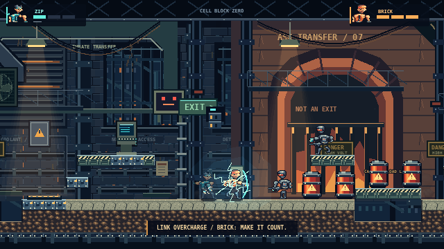
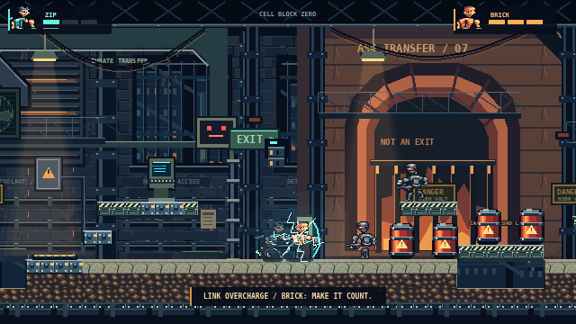
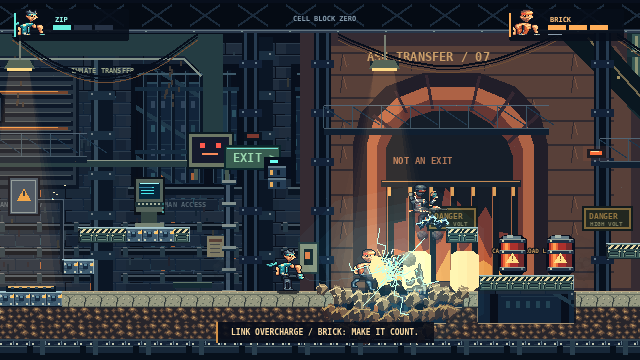
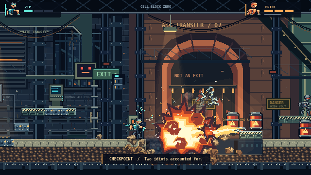
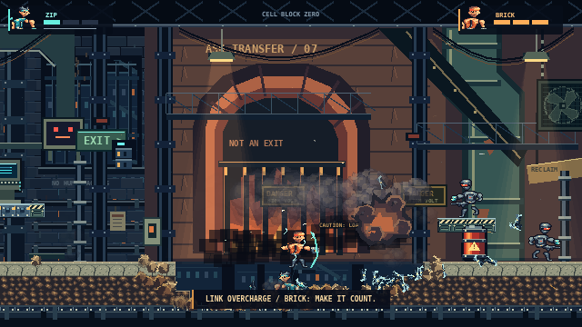
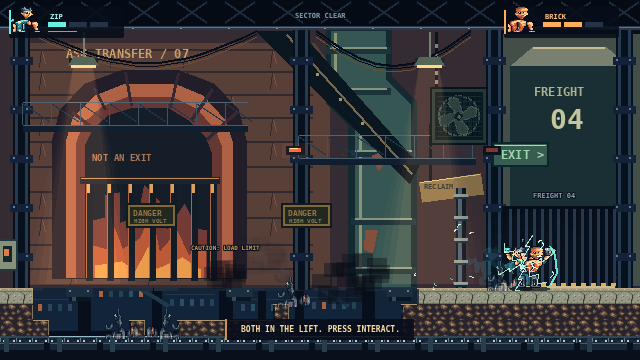

# Premium pixel art and action review

This continues the published `6abd192` slice. It is a playable combat and asset-authoring change, not a replacement cinematic. The current scale remains a 640 × 360 canvas, 16px terrain, and 48 × 48 character frames.

## Actual gameplay

[Download the 15-second gameplay video with game audio](../artifacts/premium/gameplay-15s.mp4). The raw continuous recording and its observed simulation events are in [the capture evidence](../artifacts/premium/evidence.json). The capture driver reaches the encounter by playing the existing breach and plate/terminal puzzle from the original spawn. It then operates both characters with keyboard events. It does not teleport, alter health, inject explosions, advance simulation time, or rewrite enemies/terrain.

| Moment | Actual captured frame |
| --- | --- |
| Prisoners enter the furnace bay |  |
| ZIP charges BRICK's braced shield |  |
| The charged punch lands |  |
| Separate fuel barrels detonate in sequence |  |
| Both prisoners cross the destroyed walkway |  |
| Both reach the freight lift |  |

The six sequence frames come directly from the rendered game canvas at its native 640 × 360 resolution. The separate character, puzzle, environment, and explosion screenshots in the same directory are 1280 × 720 browser captures. The video is a continuous 15-second excerpt encoded at 30fps, with no compositing or speed changes. Browser encoding can duplicate frames when rendering is slower than 30fps; the evidence records actual rendered frames and animation states separately. These are live game captures, not generated mockups.

## What changed

- ZIP, BRICK and guards now compile from individually drawn pixel grids: faces, costume shading, weapons, gloves, scarves and limbs. Explicit pose layouts replace the old sine-driven anatomy generator. Idle, running, leaping, landing, aiming, wind-up, strike, recoil, hurt, revival and victory retain the existing 32-frame sheet contract. Some in-betweens reuse parts and corpse poses use nearest-neighbor rotation; this is not a claim that all 96 frames are unique full-body drawings.
- Guards patrol, acquire unobstructed targets, visibly aim for 0.42 seconds, fire, recoil, become stunned, and fall when their platform disappears. Defeated guards retain physical knockback. ZIP bolts use swept collision, electrical impact and a short secondary stun on a nearby visible guard.
- BRICK's punch has a real 0.14-second wind-up. Hold interact to brace; ZIP can shoot into that shield to charge a 3-second window for a larger shock punch. Facing an incoming enemy shot reflects it. These decisions, projectiles, charge timers, knockback and damage all run in the server simulation, not the renderer.
- The furnace encounter has four guards and a four-drum chain spanning a fragile catwalk. Fuses stagger separate detonations. Blasts remove actual platforms and floor tiles; the altered lower route stays traversable. The pressure plate, terminal and original escape route remain intact.
- Worn ochre plaster, faded green paint, a recessed cell/bunk, tally marks, the arched ash furnace, rust-colored masonry and a green exhaust stack replace the uniform blue treatment in key areas. The distant cold architecture remains visible through open bays. Pale platform edges and warm lamps establish readable foreground surfaces.
- Fuel fire uses six individually plotted silhouettes and drawn internal curls, with fast ignition and a slower smoke phase. Concrete hits emit dust and impact shards; charged metal impacts emit cyan arcs. Staggered fragments, local stepped light spill, sparks and evolving smoke support the timing without increasing the particle budget.

## Direct reference comparison

The following real Broforce screenshots were downloaded and visually inspected. They are external references only; no pixels or game assets were copied into the project.

1. [Broforce temple/co-op screenshot, VirtualCup's localization documentation](https://raw.githubusercontent.com/VirtualCup/Broforce_CN/main/Preview/Preview_2.png). This is gameplay with localized speech/UI, not an original NO WAY OUT image. It shows compact heroes, layered jungle silhouettes, chipped masonry borders, ladders, enclosed black interiors and asymmetric vertical paths.
2. [Broforce interior gameplay, Spooktober mod documentation](https://raw.githubusercontent.com/Gorzontrok/Mods-Broforce/master/Spooktober/.img/Another-Map.jpeg) and [its exterior scene](https://raw.githubusercontent.com/Gorzontrok/Mods-Broforce/master/Spooktober/.img/A-Map.jpeg). These are explicitly modded Broforce screenshots: the palette/character changes are not treated as stock Broforce art direction. They are useful for surface-edge texture, dark-space hierarchy, foreground silhouettes and layered room composition.

Steam's reference endpoints returned proxy 403 responses in the earlier pass. The accessible community screenshots above supply a real visual comparison, with the stated source limitations. They are static views: they cannot establish animation timing, explosion evolution, or combat-frequency parity.

| Area | Comparison and remaining difference |
| --- | --- |
| Characters | Our new faces, scarf, armor and gauntlet have deliberate pixel clusters and readable colors. Broforce's reference silhouettes pack more personality into fewer pixels. Our reused limb parts and similar torso proportions remain visible. No further sprite enlargement was used. |
| Texture | Drawn chips and material grids improve the prison surfaces. Broforce distributes sparse interior texture behind much richer irregular edge clusters. Our floors still repeat more obviously, and the large plaster/furnace surfaces have simpler shading. |
| Animation | The recorded run verifies movement contacts, jump/fall, wind-up/strike, guard aiming/recoil and evolving fire. We still use a small pose library; the still references do not justify claiming equivalent animation craft. |
| Contrast | Cyan/orange heroes and the rust furnace improve separation from the cold background. The reference uses stronger black interior masses and fewer competing bright edges. Our railings and signage still compete in some frames. |
| Environment variety | Cells, open observation bays, furnace masonry and the exhaust stack provide distinct material zones. Broforce has more varied broken contours, vegetation, props and multi-floor route silhouettes. This pass deliberately remains one prison sector. |
| Destruction | The real chain removes the catwalk, changes guard support and opens a lower route. Most of our backdrop is still non-colliding scenery. Broforce's reference compositions imply more extensive vertical structures; our terrain topology is simpler. |
| Effects | The clip demonstrates separate fuel bursts, cyan charge, dust, smoke, fragments, light spill and hit-stop. Our flame silhouettes remain more angular and our smoke more repetitive. The available reference stills contain no comparable peak explosion, so matching its effects quality remains unproven. |
| Overall composition | The furnace is a recognizable focal silhouette, with a readable breach and exit. Our encounter remains horizontally staged and more regular than Broforce's stacked, asymmetric terrain and negative space. |

**Assessment:** the assets and combat are materially improved and the action is real and cooperative. This remains an original, polished vertical-slice prototype; commercial Broforce visual parity is not established.

## Recovery and reproducibility

The interrupted working tree, including both original recordings and all source changes, was committed unchanged as `bc0beac` on `recovery/premium-action-2026-10-22` and pushed before validation edits. `artifacts/showcase/` is that recovered evidence, not the current deliverable. In particular its older `gameplay-15s.webm` filename predates exact duration validation; use the new MP4 linked above.

The [previous published scene at 6abd192](https://github.com/shikherbharangar/no-way-out-exe/blob/6abd192a4a23e49ccbf44f1d1adbae2cd31c926a/artifacts/visual-review.md) remains available for comparison. No reset, clean, discarded changes or history rewrite was used.

With the development server and game server running:

```bash
npm run capture:showcase
npm run capture:gameplay
npm run export:showcase
npm run test:network:action
```

Captures default to `artifacts/premium/`; set `CAPTURE_DIR` to keep another run separately. FFmpeg/ffprobe are needed only for the MP4 export/verification. The original recordings remain in the recovery commit. See [validation](VALIDATION.md) for the checks and their limits.
