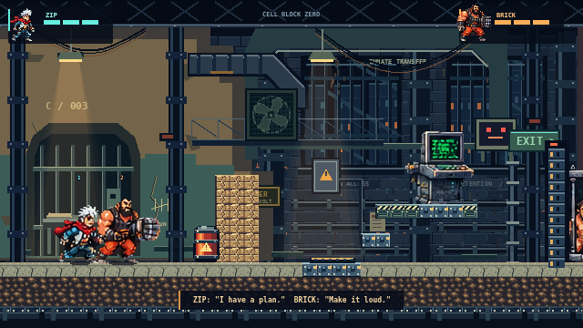
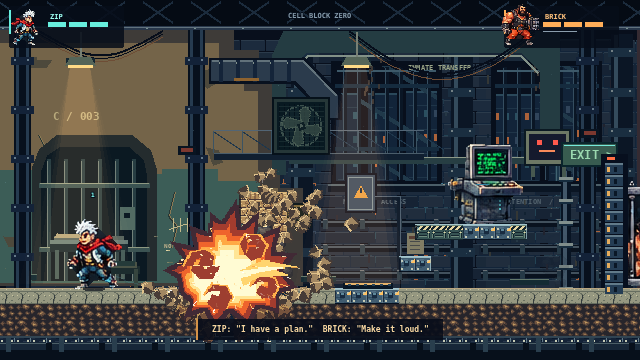
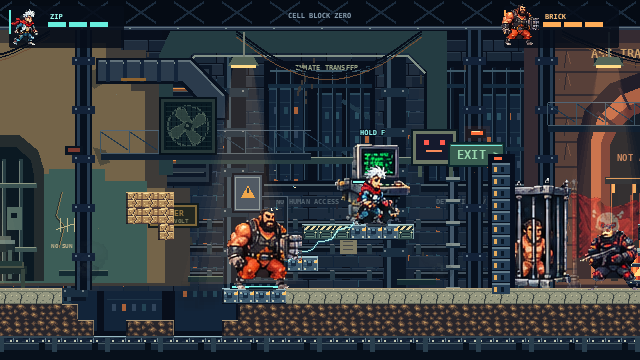
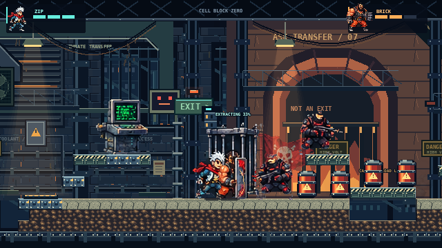
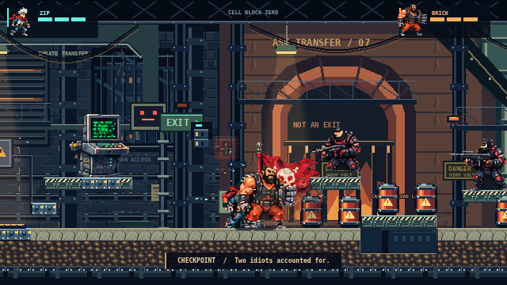

# Supplied art integration — playable review

Branch: `approved-art-integration`, created from verified stable main `69eba18`. No rejected art branch was merged. Earlier unfinished work was preserved locally in separate commits (`26b5d09`, `8d28341`) before switching branches. **This is an integration review, not visual approval or an animation-completeness claim.**

## Actual gameplay

[15-second gameplay MP4](../artifacts/supplied/action/gameplay-15s.mp4) · [Original recording](../artifacts/supplied/action/gameplay-source.webm) · [Interactive inspection page](../artifacts/supplied/index.html) · [Complete inventory](SUPPLIED_ART_INVENTORY.md).

The HTML page works when the repository is served with Vite at `/artifacts/supplied/index.html`; GitHub displays HTML source. The actual screenshots below work directly in GitHub.

| Real 640×360 gameplay | Pixel inspection |
|---|---|
|  | [Exact 2× PNG](../artifacts/supplied/acceptance/01-idle-normal-2x.png) |
|  | [Exact 2× PNG](../artifacts/supplied/acceptance/02-running-normal-2x.png) |
|  | [Exact 2× PNG](../artifacts/supplied/acceptance/03-electric-attack-normal-2x.png) |
|  | [Exact 2× PNG](../artifacts/supplied/acceptance/04-explosion-normal-2x.png) |
|  | [Exact 2× PNG](../artifacts/supplied/acceptance/06-cooperative-terminal-normal-2x.png) |
|  | [Exact 2× PNG](../artifacts/supplied/acceptance/08-rescue-interaction-normal-2x.png) |
|  | [Exact 2× PNG](../artifacts/supplied/acceptance/09-checkpoint-normal-2x.png) |

Nine native capture triplets include idle, running, attack, explosion, destroyed wall, terminal, cage, rescue and checkpoint. Each has normal, neutral-backdrop and restored versions at the same simulation tick. Playwright uses the real UI and keyboard controls. The scene pauses only for cosmetic backdrop comparisons; simulation state is not rewritten. The separate action recording is continuous actual gameplay with sound, guard combat, cooperative electrical charge, a rescue, the giant fist, chain explosions and the escape. It contains no mockup images, replacement frames, compositing or speed changes.

## Source fidelity and rendering

All **83 supplied files, including 79 PNGs**, are stored unchanged under `art/supplied/source/`. The five runtime atlases are byte-for-byte copies in `public/assets/supplied/`. `art/supplied/inventory.json` records every source file's hash, size, PNG dimensions, alpha and named-frame boundaries. The original archive contains 57 named frames. Individual sprites match the atlases' visible pixels; four differ only in irrelevant RGB values beneath alpha zero. All gameplay atlas transparency is binary.

`SuppliedArt` registers named frames using each frame's width and height, rather than fitting art into the old 48×48 cells. Metadata contains measured foot/body anchors and source-facing direction, including BRICK's left-facing punch drawing. The gameplay renderer uses **1 original artwork pixel per world pixel**, integer positions, nearest-neighbor filtering and a reflected anchor when facing changes. Whole cells, including oversized fists and effects, are retained. HUD thumbnails use a uniform 1:2 nearest-neighbor reduction, never nonuniform stretching.

The sprite hitboxes remain the original **14×25** simulation boxes. Consequently the supplied 70–81px standing artwork is larger than its collision volume. This deliberate separation preserves existing movement, platform reachability and combat rules; hitbox rebalancing would be a distinct gameplay change. Per-frame anchors remove placement errors but cannot repair anatomy, perspective or missing body pixels already present in the artwork.

An isolated Phaser test renders **all 57 frames in both directions (114 cases)** and compares every visible pixel against the corresponding original atlas on the same background. It verifies full dimensions, scale, alpha, flipping and anchor projection. This is a rendering test, clearly separate from gameplay screenshots. [Renderer evidence](../artifacts/supplied/render-evidence.json).

## Playable integration and narrow gameplay addition

- ZIP and BRICK use the supplied key poses throughout both existing sectors, including replay. Pose selection follows actual movement, attack, dash, hurt, death and revival state.
- Four existing guard slots use supplied guard, shotgunner, sniper and heavy-trooper silhouettes. Their original authoritative patrol/aim/shoot/damage rules remain unchanged. Static art does not imply new weapon statistics or AI.
- The supplied terminal replaces the existing terminal image. The checkpoint flag displays the existing shared checkpoint state; its art does not introduce another save system.
- The supplied cage adds one **optional** rescue at `(647,288)`. After the cooperative gate is open, a living, grounded player within 42px holds Interact for 0.75 seconds. Release resets an unfinished hold. Rescue is awarded once, restores one health point to each living player (capped at three), and hoists the evacuation cage away. The supplied health icon marks the actual reward.
- The host owns the rescue timer, saved flag and reward. Two additive snapshot fields and one event represent it; the transport protocol, room codes, input messages, reconnect tokens and server authority remain intact. Old snapshots default to an unrescued cage. A saved rescue survives checkpoint respawn and cannot be farmed; a new game clears it. A ghost still requires the existing partner-revival interaction.

The new rescue state is the only authoritative gameplay addition needed for the explicitly requested demonstration. Movement, collisions, destruction, guard rules, puzzles, layout generation, bosses and level transitions are unchanged. No levels, aliens, bosses, endless-generation features, fake pickups or nonfunctional unlocks were added.

## What is unfinished in the supplied artwork

The pack's README describes it as **prototype extracted key poses**, not finished animation. Its suggestions are import guidance, not additional user instructions; the current user explicitly requested flag/cage integration, so that work did not wait for the README's suggested later stage.

There is only one image per action, so running holds the supplied run key; no invented in-betweens, limb warping or generic replacement drawings are used. Landing reuses idle. ZIP's revival reuses hack; BRICK's revival reuses shield. Enemy movement/aim/death have no separate supplied keys; the static silhouette moves with the actual simulation and fades on defeat. The pack's named hurt/death poses are used as supplied, even where they resemble effects/action poses instead of a convincing collapse.

BRICK's punch drawing contains a detached fist and a partially missing body; some ZIP frames include stray red fragments or effect remnants. These defects are visible in the source previews and are preserved, not caused by runtime clipping. They need manual source-art cleanup and consistent additional drawings. The complete per-asset notes are in the inventory. No professional animation or Broforce-quality parity is claimed.

The reference folder contains concept boards, environmental examples and VFX examples. Those are **not** tileable terrain, animation atlases or actual gameplay captures. Existing stable-main terrain, background and explosion systems are retained. No rejected reboot scenery or generated replacement actors were introduced.

## Verification and limits

See [the validation record](SUPPLIED_ART_VALIDATION.md). The renderer's initial software-GPU sample recorded 69 frames in 3.008 seconds (median 43.2ms, p95 56.5ms); this is headless SwiftShader, not a production desktop GPU benchmark. The action evidence separately records actual rendered frames and wall time. A 30fps video export can repeat frames and is not a 60fps performance claim.

No production deployment, real internet latency or physical-controller testing is claimed. The Vercel frontend still needs a separately hosted authoritative WebSocket backend. Main is not merged or overwritten.
