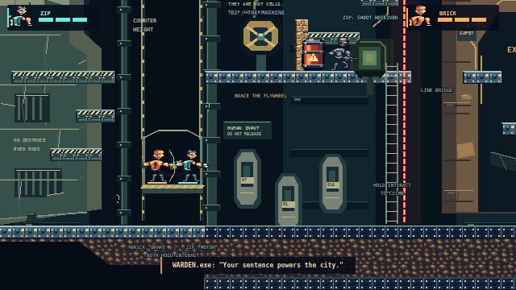
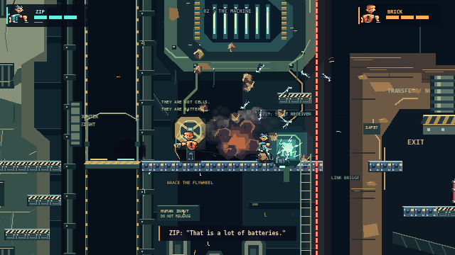
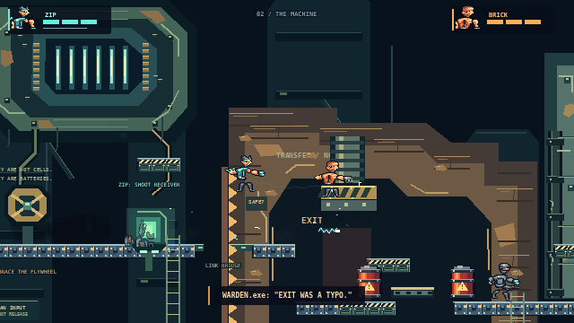
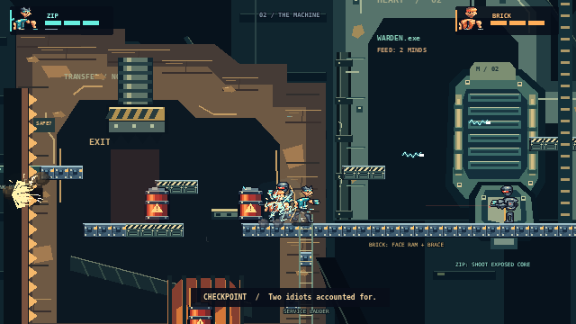
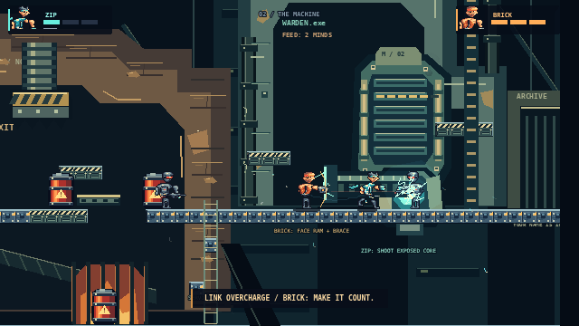
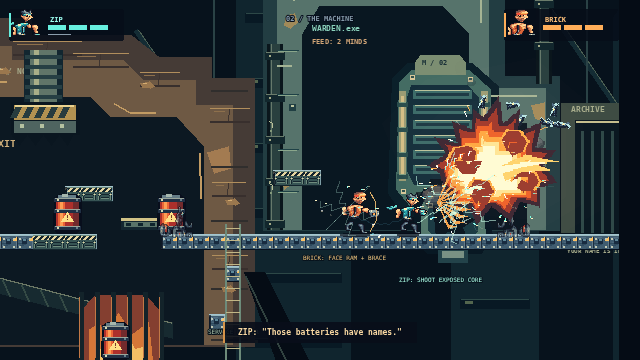
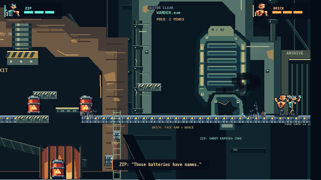

# Sector 02 — THE MACHINE

A complete continuation of Cell Block Zero, built from `f6cdd58`. Finish the prison, then **both hold interact in the freight lift for 1.2 seconds**. The same two characters, combat, revival and authoritative server continue into the new sector. Final results appear after both reach the archive beyond the magnetic heart.

## Play the route

| Space | Interaction and alternatives |
| --- | --- |
| Counterweight shaft | BRICK stands on the cage's amber left side; ZIP takes the cyan right side. Both hold interact to brake and power a 192px ascent. Releasing either control stops it. A living player below can call it back by holding interact near the shaft. |
| Memory dynamo | BRICK breaks the service partition; ZIP can climb the maintenance shelves or follow the breach. BRICK braces the brass flywheel while ZIP shoots the receiver twice. This latches power, disables the laser and extends the link bridge. The prisoner-sized battery shells explain what the machinery consumes. |
| Transfer line | The misleading EXIT sign triggers a warning, then a mechanical crusher and advancing shear wall. Destructible catwalks, a moving shuttle and the lower service route offer different crossings. Hold interact at a ladder to climb out. The checkpoint before the trap makes a failed attempt recoverable. |
| Magnetic heart | BRICK faces right and braces on the amber catch mark as the ram strikes. Keep holding it: ZIP moves past him and shoots the exposed core. Six hits over multiple openings disable the engine and unlock the archive. Letting go closes the core early. Both must reach the exit. |

The two principal new cooperative mechanisms are a two-operator moving elevator and a caught-ram vulnerability window. The flywheel/receiver adds a projectile-operated synchronized relay. Existing shield charging, reflection, destructible terrain, enemy aiming and revival remain available throughout.

A total wipe restarts the latest shared checkpoint. If a hologram is stranded, **both players hold interact for three seconds** to recall both characters to that checkpoint. This is a host-owned action and works online. The ordinary near-partner revival is faster. Reinforced supports, recovery floors and ladders cannot be destroyed; optional walls and catwalks can.

## Authored generation foundation

`src/game/machine.ts` contains six templates in four constrained slots: one shaft, two dynamo variants, two transfer variants and one arena. A 32-bit seeded selector chooses **four possible layouts**, rather than claiming an unbounded dungeon generator. Each template declares matching entrance/exit coordinates, required abilities and progression grants. Canonical socket/ability validation runs when a layout is generated.

Local orientation accepts a room seed; replay increments it. Online rooms get a server-selected seed which is included in snapshots. Reconnection preserves that exact layout. Variants change maintenance shelves, the broken crossing and crusher position; the room sequence and key storytelling stay authored.

The test suite checks 512 seeds for deterministic selection and valid connections, then plays nine seeds covering all four combinations with ordinary controls, including the complete boss and shared exit. Separate tests demolish every breakable route surface and finish the remaining route, exercise recovery ladders, recall a stranded hologram, and verify cage recall. These checks establish reachability of the shipped templates; new templates still require their own executable route tests.

## Real gameplay evidence

[Download continuous gameplay with game audio](../artifacts/machine/gameplay.mp4) · [Browser recording evidence](../artifacts/machine/browser-evidence.json) · [Authoritative campaign/reconnect evidence](../artifacts/machine/network-evidence.json) · [Two-browser online evidence](../artifacts/machine/online-browser-evidence.json).

The capture plays Cell Block Zero from spawn, operates the normal freight-lift transition, and records THE MACHINE through its exit. It sends keyboard events and observes state. It does not teleport, inject effects, alter health, replace assets for screenshots or advance the simulation manually. Screenshots are native 640 × 360 frames from Phaser's post-render event. The video is an uncut recording of the new sector, encoded without speed changes.

| Moment | Rendered gameplay |
| --- | --- |
| Two-person counterweight lift |  |
| Powered relay under fire |  |
| False exit / crusher warning |  |
| Live transfer-line pursuit |  |
| BRICK catches the ram; ZIP attacks |  |
| Heart destroyed |  |
| Both reach the archive |  |

The two online clients also complete the full campaign through the normal lobby. Their [ZIP view](../artifacts/machine/08-online-zip.png) and [BRICK view](../artifacts/machine/09-online-brick.png) are captured after rendering the shared boss state.

## Visual comparison

The real [Broforce temple/co-op reference](https://raw.githubusercontent.com/VirtualCup/Broforce_CN/main/Preview/Preview_2.png) and [modded Broforce industrial interior](https://raw.githubusercontent.com/Gorzontrok/Mods-Broforce/master/Spooktober/.img/Another-Map.jpeg) were inspected alongside actual captured frames. The latter is a community modification, not evidence of stock character/palette choices. Neither still demonstrates comparable explosion or animation timing. No reference pixels were copied or traced.

| Area | Result and remaining difference |
| --- | --- |
| Scale and characters | Existing 48px animation sheets, 16px terrain and 640 × 360 native canvas are retained. The heroes run, jump, attack, recoil and brace. Broforce's silhouettes remain more varied and compact; our shared pose vocabulary is smaller. |
| Composition | The tall empty cage shaft, suspended dynamo, broken warm-stone transfer arch and tall ceramic engine replace a single horizontal bay. Foreground braces, cold distant structures and sparse warm accents separate depth. Broforce still has richer irregular edge clusters and denser interwoven routes. |
| Materials | Four new original PNG assets describe worn stone, chipped enamel, copper coils, piston bands, battery shells and individual machine parts. Shapes are placed in editable integer-coordinate compositions, not generated from random geometric rooms. Broad background faces remain simpler than the reference artwork. |
| Motion and action | Moving cage, counterweight, shuttle, crusher, ram, projectiles, guards and breakable catwalks interact in real simulation. The selected sequence is deliberately legible; Broforce typically has more simultaneous combat actors and emergent destruction. |
| Light and effects | The previous fire keyframes, smoke, material fragments and stepped light spill are preserved. Cyan core exposure and warm furnace accents create focal points. Smoke still repeats its small sheet; background architecture has baked shading rather than dynamic relighting. |
| Destruction | Optional shelves, service walls and catwalks really disappear. Recovery floors and puzzle anchors are reinforced to prevent progression loss. Large painted background structures are scenery, so this is not fully destructible architecture. |

This is a complete playable two-sector chapter and a constrained procedural foundation. **Commercial Broforce visual parity is not claimed.** The archive beyond the exit and further sectors remain future work.

## Reproduce

With Vite and the dedicated server running:

```sh
npm run build
npm test
npm run test:browser
npm run test:network
npm run test:network:action
npm run test:network:machine
npm run test:browser:machine
npm run test:browser:machine:online
```

The last two commands play the full campaign through actual browser clients. `capture:machine` aliases the local campaign capture. Use `CAPTURE_DIR` to retain a different local capture. Run recording without simultaneous build/asset generation or other Chromium jobs. The development inspection hook is absent from the production build; `test:production` verifies asset loading and the normal production UI separately.

`npm run assets` rebuilds the four machine PNGs from `scripts/art/machine.py`, alongside the unchanged original art pipeline. `npm run export:machine` converts and probes the recorded video and verifies the PNG files. FFmpeg/ffprobe are required for that export.
